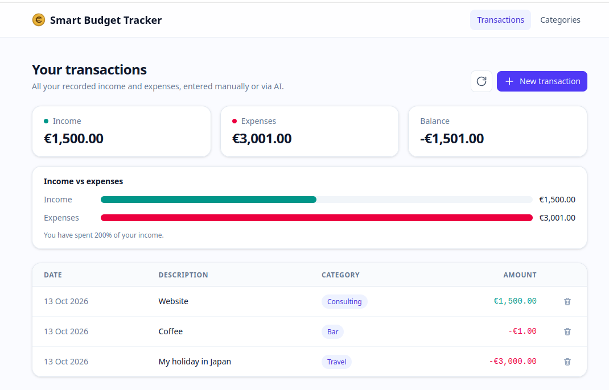
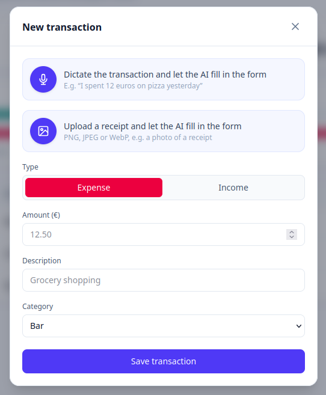
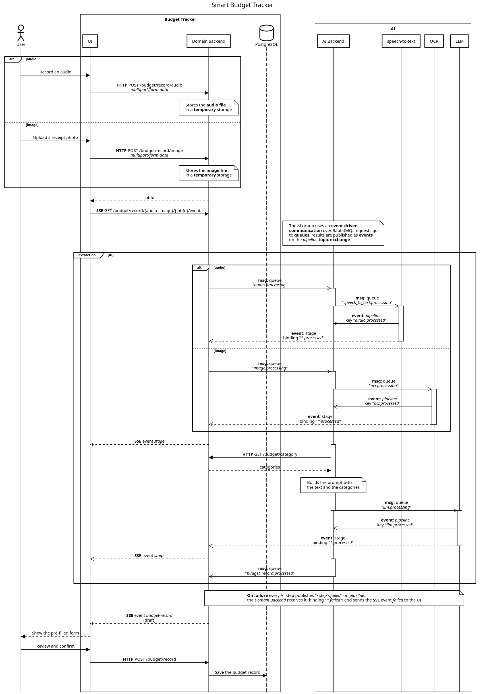

# Smart Budget Tracker

An AI-powered budget tracker for those who are tired of doing it manually. Developed the old-fashioned way.

It is a set of microservices written in Node.js and Python that communicate through a message broker (RabbitMQ).
The AI features run locally on open-weight models:
**speech-to-text** with Whisper `large-v3-turbo` ([faster-whisper](https://github.com/SYSTRAN/faster-whisper)),
**OCR** with [PaddleOCR](https://github.com/PaddlePaddle/PaddleOCR),
and an **LLM** (Qwen 2.5 3B) served by [Ollama](https://ollama.com).

<p align="center">
  
  
</p>

## How it works

1. Click **New transaction**, then dictate it (e.g. *"I spent 12 euros on pizza"*) or upload a photo of a receipt.
2. The file goes through the AI pipeline: speech-to-text or OCR extracts the text, then the LLM turns it into a transaction (type, amount, category and description), picking the category among yours.
3. The UI shows the progress of each step live, then fills in the form.
4. You review it and save.

## Why

Just an experiment to test my new GPU and to learn how to use local open-weight AI models and a message broker.

## Requirements

- Docker with Docker Compose
- An NVIDIA GPU with the [NVIDIA Container Toolkit](https://docs.nvidia.com/datacenter/cloud-native/container-toolkit/latest/install-guide.html): the `ollama` and `speech-to-text` services need it to start

## Setup

```bash
git clone https://github.com/giovannitranquillini/smart-budget-tracker.git
cd smart-budget-tracker
docker compose build
docker compose up
```

The first build takes a while: the Whisper and PaddleOCR models are downloaded into the images.
On the first start, Ollama also pulls `qwen2.5:3b` (~2 GB), which is kept in a volume.

The database is set up automatically: before the backend starts, the `migrate` job applies the [Prisma migrations](backend/src/prisma/migrations), creating the tables and the default categories.
Already applied migrations are skipped, so it is safe on every start.

Once everything is up:

| What | URL |
|---|---|
| Web UI | http://localhost:5173 |
| REST API | http://localhost:3001 |
| API docs (Swagger) | http://localhost:3001/docs |
| RabbitMQ management | http://localhost:15672 (`admin` / `admin`) |

You can also run each service on its own: see the README in its folder (linked in the table below).

### Stop and reset

```bash
docker compose down      # stop everything, keeping the data
docker compose down -v   # stop everything and delete the volumes
```

The volumes contain the database, the uploaded files and the Ollama model: after `down -v`, the next start sets up an empty database and pulls the model again.

## Architecture

### Services

| Service | Folder | Stack | Role |
|---|---|---|---|
| web | [`ui/`](ui) | React, TypeScript, Vite | Transactions and categories, audio recording, receipt upload |
| backend | [`backend/`](backend) | Node.js, TypeScript, Fastify, Prisma | Domain logic and REST API, stores the uploaded files, streams the progress to the UI (SSE) |
| ai-backend | [`ai/backend/`](ai/backend) | Node.js, TypeScript | Orchestrates the AI pipeline and builds the LLM prompts |
| speech-to-text | [`ai/speech-to-text/`](ai/speech-to-text) | Python, faster-whisper | Transcribes the audio (GPU) |
| ocr | [`ai/ocr/`](ai/ocr) | Python, PaddleOCR | Reads the text of the receipt (CPU) |
| llm | [`ai/llm/`](ai/llm) | Python | Asks the LLM to turn the text into a transaction (JSON) |
| postgres | | PostgreSQL | Persistence |
| rabbitmq | [`rabbitmq/`](rabbitmq) | RabbitMQ | Message broker |
| ollama | | Ollama | Serves Qwen 2.5 on the GPU |

### Messaging

The services exchange two kinds of messages:

- **Commands** ("do this") are sent straight to a **queue**, consumed by a single service.
- **Events** ("this is done") are published on the `pipeline` **topic exchange** with a routing key `<step>.<outcome>`: every queue bound to a matching key gets a copy.

| Service | Consumes | Produces |
|---|---|---|
| ai-backend | queue `audio.processing` | queue `speech_to_text.processing` |
| speech-to-text | queue `speech_to_text.processing` | event `audio.processed` or `speech_to_text.failed` |
| ai-backend | queue `image.processing` | queue `ocr.processing` |
| ocr | queue `ocr.processing` | event `ocr.processed` or `ocr.failed` |
| ai-backend | events `audio.processed`, `ocr.processed` | queue `llm.processing` or event `prompt.failed` |
| llm | queue `llm.processing` | event `llm.processed` or `llm.failed` |
| ai-backend | event `llm.processed` | queue `budget_record.processed` |
| backend | queue `budget_record.processed` | the draft, sent to the UI |

The backend also follows the whole pipeline with two wildcard bindings:

- `*.processed` → a `stage` SSE event, so the UI can show the progress of each step;
- `*.failed` → a `failed` SSE event, so the UI shows the error right away.

### Sequence diagram



## License

[Apache 2.0](LICENSE)
